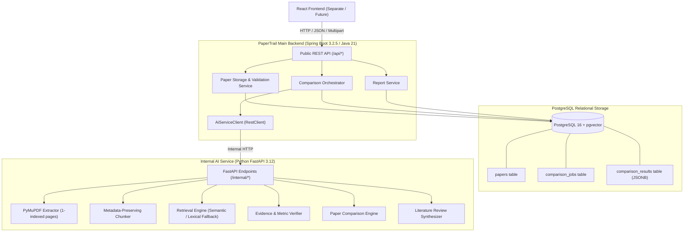

# PaperTrail

> **An AI-Powered Research Paper Comparison and Evidence Verification System Using Retrieval-Augmented Generation (RAG)**

PaperTrail is an evidence-grounded research assistant designed to help students and researchers compare multiple scientific papers, verify claims against extracted source text, cross-check numerical metrics and evaluation units, and export structured literature-review reports.

---

## 1. System Architecture



---

## 2. Directory Structure

```text
paperTrial/
├── README.md
├── .gitignore
├── .env.example
├── docker-compose.yml
├── frontend/
│   └── .gitkeep               # Frontend directory reserved for separate implementation
│
├── backend-java/              # Spring Boot Main Application
│   ├── pom.xml
│   └── src/
│       ├── main/
│       │   ├── java/com/papertrail/
│       │   │   ├── PaperTrailApplication.java
│       │   │   ├── client/
│       │   │   │   └── AiServiceClient.java
│       │   │   ├── config/
│       │   │   │   ├── AiServiceConfig.java
│       │   │   │   ├── CorsConfig.java
│       │   │   │   └── OpenApiConfig.java
│       │   │   ├── controller/
│       │   │   │   ├── ComparisonController.java
│       │   │   │   ├── HealthController.java
│       │   │   │   ├── PaperController.java
│       │   │   │   └── ReportController.java
│       │   │   ├── dto/
│       │   │   │   ├── ApiError.java
│       │   │   │   ├── ComparisonRequest.java
│       │   │   │   ├── ComparisonResponse.java
│       │   │   │   ├── EvidenceResponse.java
│       │   │   │   └── PaperResponse.java
│       │   │   ├── entity/
│       │   │   │   ├── ComparisonJob.java
│       │   │   │   ├── ComparisonResult.java
│       │   │   │   └── Paper.java
│       │   │   ├── enums/
│       │   │   │   ├── JobStatus.java
│       │   │   │   └── PaperStatus.java
│       │   │   ├── exception/
│       │   │   │   ├── GlobalExceptionHandler.java
│       │   │   │   └── ResourceNotFoundException.java
│       │   │   ├── repository/
│       │   │   │   ├── ComparisonJobRepository.java
│       │   │   │   ├── ComparisonResultRepository.java
│       │   │   │   └── PaperRepository.java
│       │   │   └── service/
│       │   │       ├── ComparisonService.java
│       │   │       ├── PaperService.java
│       │   │       └── ReportService.java
│       │   └── resources/
│       │       ├── application.yml
│       │       └── db/migration/
│       │           └── V1__create_initial_tables.sql
│       └── test/
│           └── java/com/papertrail/
│               ├── ComparisonServiceTest.java
│               └── PaperControllerTest.java
│
└── ai-service/                 # Python FastAPI AI Service
    ├── Dockerfile
    ├── requirements.txt
    ├── .env.example
    ├── app/
    │   ├── __init__.py
    │   ├── config.py
    │   ├── exceptions.py
    │   ├── main.py
    │   ├── schemas.py
    │   ├── services/
    │   │   ├── __init__.py
    │   │   ├── comparison.py
    │   │   ├── embeddings.py
    │   │   ├── evidence_verifier.py
    │   │   ├── pdf_extractor.py
    │   │   ├── report_generator.py
    │   │   ├── retrieval.py
    │   │   └── text_chunker.py
    │   └── utils/
    │       ├── __init__.py
    │       └── text_utils.py
    └── tests/
        ├── test_evidence_verifier.py
        ├── test_health.py
        ├── test_pdf_extractor.py
        └── test_text_chunker.py
```

---

## 3. Technology Stack

| Layer | Technologies |
|---|---|
| **Main Application Backend** | Java 21, Spring Boot 3.2.5, Spring Data JPA, Flyway, RestClient, Springdoc OpenAPI 2.5.0 |
| **Relational Database** | PostgreSQL 16 (with optional `pgvector` container) |
| **Internal AI Microservice** | Python 3.12, FastAPI, Uvicorn, Pydantic v2, PyMuPDF (fitz), scikit-learn, NumPy |
| **Testing** | JUnit 5, Mockito, MockMvc, Pytest, FastAPI TestClient |
| **Containerization** | Docker, Docker Compose |

---

## 4. Default Service Ports

| Service | Protocol / URL | Notes |
|---|---|---|
| **Spring Boot REST API** | `http://localhost:8080` | Public application backend |
| **Spring Boot Swagger UI** | `http://localhost:8080/swagger-ui/index.html` | Interactive API documentation |
| **FastAPI Internal AI Service**| `http://localhost:8001` | Internal extraction and RAG worker |
| **FastAPI OpenAPI Docs** | `http://localhost:8001/docs` | Internal API inspection |
| **PostgreSQL Database** | `localhost:5432` | Relational persistence (`papertrail`) |

---

## 5. Prerequisites

- **Java JDK 21+** (`javac -version`)
- **Apache Maven 3.9+** (`mvn -version`)
- **Python 3.11 or 3.12+** (`python --version`)
- **Docker & Docker Compose** (optional, recommended for PostgreSQL)

---

## 6. Setup & Execution Guide

### Step 1: Start PostgreSQL

Using the provided Docker Compose configuration:

```bash
docker compose up -d postgres
```

This launches a PostgreSQL 16 container preloaded with the `pgvector` extension on port `5432`.
Default database: `papertrail`, user: `papertrail`, password: `change_me`.

*(If using an existing local PostgreSQL, ensure a database named `papertrail` is created).*

### Step 2: Configure Environment

Copy `.env.example` to `.env`:

```bash
cp .env.example .env
```

Key environment options:
```ini
POSTGRES_DB=papertrail
POSTGRES_USER=papertrail
POSTGRES_PASSWORD=change_me
DATABASE_URL=jdbc:postgresql://localhost:5432/papertrail

AI_SERVICE_URL=http://localhost:8001
PAPER_STORAGE_DIR=./data/papers
MAX_FILE_SIZE_MB=20
MAX_FILES_PER_REQUEST=5

# Optional LLM & Embedding provider (defaults to deterministic fallback if none)
LLM_PROVIDER=none
LLM_API_KEY=
EMBEDDING_PROVIDER=none
```

### Step 3: Run the Python FastAPI AI Service

In a terminal:

```bash
cd ai-service
pip install -r requirements.txt
python -m uvicorn app.main:app --host 0.0.0.0 --port 8001 --reload
```

Verify service status: `http://localhost:8001/internal/health`

### Step 4: Run the Spring Boot Application

In a separate terminal:

```bash
cd backend-java
mvn spring-boot:run
```

Flyway will automatically execute database migrations (`V1__create_initial_tables.sql`) on startup.
Swagger UI will be accessible at: `http://localhost:8080/swagger-ui/index.html`

---

## 7. Public REST API Endpoints

### 7.1 Health & Connectivity
- **`GET /api/health`**
  - Returns Spring Boot status and whether the internal AI service is reachable.

### 7.2 Papers Management
- **`POST /api/papers`** (`multipart/form-data`)
  - Parameters: `files` (up to 5 PDF files, max 20 MB each)
  - Validates extension, MIME type, calculates SHA-256 for deduplication, stores file with UUID, extracts text with PyMuPDF, and stores metadata in PostgreSQL.
- **`GET /api/papers?page=0&size=20`**
  - Paginated list of uploaded papers.
- **`GET /api/papers/{id}`**
  - Get metadata and processing status (`UPLOADED`, `EXTRACTING`, `EXTRACTED`, `FAILED`).
- **`DELETE /api/papers/{id}`**
  - Safely deletes paper record and associated storage file.

### 7.3 Multi-Paper Comparison
- **`POST /api/compare`** (`application/json`)
  - Body:
    ```json
    {
      "paperIds": [
        "a4f8d9b1-5e2a-4f51-b8f2-e2c7a5223011",
        "c8b2e1a3-6f1d-4d7a-a3e9-f1a2b3c4d5e6"
      ],
      "question": "How do their evaluation metrics and benchmarks compare?"
    }
    ```
  - Validates that at least two papers exist and are in `EXTRACTED` state.
  - Creates a comparison job in PostgreSQL, calls AI service, persists structured JSON results, and returns comparison matrix.
- **`GET /api/compare/{jobId}`**
  - Retrieve the status and results of a comparison job.

### 7.4 Evidence Verification
- **`POST /api/evidence/verify`** (`application/json`)
  - Body:
    ```json
    {
      "claim": "The model achieved 94.5% accuracy on ImageNet",
      "paperIds": ["a4f8d9b1-5e2a-4f51-b8f2-e2c7a5223011"]
    }
    ```
  - Returns verification status:
    - `SUPPORTED`: Claim corroborated by exact figures and quotes with page numbers.
    - `CONTRADICTED`: Numeric mismatch, opposite polarity, or conflicting claim.
    - `INSUFFICIENT_EVIDENCE`: Context not found in extracted text.
    - `NOT_COMPARABLE`: Metrics evaluate different benchmarks, protocols, or units (e.g. BLEU vs accuracy).

### 7.5 Literature Review Report
- **`GET /api/reports/{comparisonId}/markdown`**
  - Returns a publication-ready literature review report in Markdown (`text/markdown`) synthesizing problem formulations, comparative matrices, grounded quotations, candidate research gaps, and uncertainties.

---

## 8. Verification & Grounding Principles

1. **Zero Hallucination Guarantee:** If an author does not state a metric, dataset size, or limitation, the system explicitly marks it as `Not reported`.
2. **Page-Level Grounding:** All extracted statements and evidence citations retain 1-indexed page references (`[Page X]: quotation`).
3. **Candidate Research Gaps:** Automated gap identifications derive strictly from authors' explicit limitation and future work sections, and are explicitly marked as *candidates requiring manual review*.
4. **Deterministic Fallbacks:** The system functions fully offline without external API keys. Lexical TF-IDF retrieval and rule-based heuristic extraction are used whenever LLM or embedding providers are disabled.

---

## 9. Automated Testing

### Running Spring Boot Tests
```bash
cd backend-java
mvn test
```
- **16 automated tests executed:**
  - `PaperControllerTest`: PDF multipart upload validation, paper retrieval, pagination, safe deletion, 404 handling.
  - `ComparisonServiceTest`: Two-paper validation, status prerequisites, AI service failure handling, network timeout handling, JSON result persistence, evidence verification orchestration.

### Running Python AI Service Tests
```bash
cd ai-service
python -m pytest tests -v
```
- **10 automated tests executed:**
  - `test_health.py`: Health check and credential safety inspection.
  - `test_pdf_extractor.py`: Multi-page text extraction, 1-indexed page retention, empty/scanned PDF OCR detection, corrupt file handling.
  - `test_text_chunker.py`: Sliding-window chunking, metadata preservation (`paper_id`, `page_number`, `chunk_id`), whitespace normalization.
  - `test_evidence_verifier.py`: Supported numerical claims, contradictory metrics detection, unit incompatibility (`NOT_COMPARABLE`), insufficient evidence detection.

---

## 10. Current Status & Future Enhancements

### Completed in MVP
- Complete Spring Boot 3.2.5 REST backend with Flyway migrations and PostgreSQL entities.
- Complete Python FastAPI AI service with PyMuPDF page-level extraction and sliding-window chunker.
- Modern React + TanStack frontend in `frontend/paper` with paper upload, comparison matrix, evidence verification, research gaps discovery, and markdown literature report export.
- Inter-service communication via Spring `RestClient` with timeout handling and failure containment.
- Evidence and metric verification with deterministic unit and numeric mismatch detection.
- Lexical TF-IDF retrieval engine and configurable embedding service abstraction.
- Markdown literature review report generation with comparison matrices.
- 26/26 automated unit and slice tests passing across both services.

### Running the Frontend
```bash
cd frontend/paper
npm install
npm run dev
```
The frontend connects to the backend at `http://localhost:8080` (configured in `frontend/paper/.env`).

### Future Enhancements
- Asynchronous comparison job worker using Spring `@Async` or background task queues.
- OCR integration (Tesseract / EasyOCR) for image-only PDF scans.
- Production vector index persistence in pgvector tables for long-term semantic search across large libraries.
